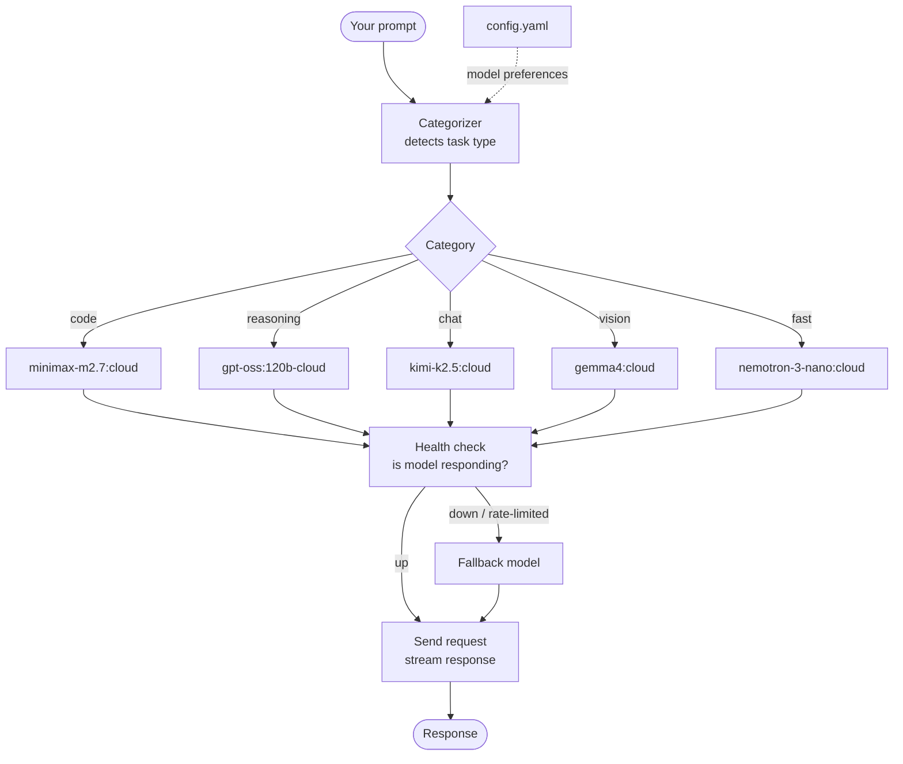

# ollama-model-router

Auto-picks the best free Ollama cloud model for your prompt. Stop guessing which model to use — just ask and it routes to the right one.

[](https://opensource.org/licenses/MIT)
[](https://www.python.org/downloads/)
[](https://github.com/RedBeret/ollama-model-router/actions/workflows/ci.yml)

## How It Works



The categorizer maps keywords and prompt patterns to a task type. The registry picks the primary model for that type from config. If the primary is down or rate-limited, it falls back to the alternate automatically.

## Install

Works on macOS, Linux, and Windows.

```bash
git clone https://github.com/RedBeret/ollama-model-router.git
cd ollama-model-router
pip install -e .
```

## Quick Start

```bash
model-router "write a python function to parse CSV files"
# -> routes to minimax-m2.7:cloud (best for code)

# or run as module
python -m model_router "write a python function to parse CSV files"
```

## Features

- Auto-detects prompt type (code, reasoning, chat, vision, search)
- Routes to the best free cloud model for that task
- Falls back to alternate models if primary is down
- Configurable model preferences via YAML
- Rate limit handling with automatic retry
- Interactive chat mode with model switching

## Default Model Assignments

| Category | Model | Why |
|----------|-------|-----|
| chat | kimi-k2.5:cloud | best all-around quality |
| code | minimax-m2.7:cloud | top coding benchmarks |
| reasoning | gpt-oss:120b-cloud | fast reasoning |
| vision | gemma4:cloud | multimodal support |
| fast | nemotron-3-nano:cloud | when speed matters most |

## Usage

```bash
# auto-route based on prompt
python -m model_router "explain quicksort step by step"

# force a specific category
python -m model_router --category code "refactor this function"

# force a specific model
python -m model_router --model kimi-k2.5:cloud "hello"

# interactive chat
python -m model_router --interactive

# list available models
python -m model_router --list
```

## Configuration

Copy `config.example.yaml` to `config.yaml` and customize:

```yaml
ollama_url: http://localhost:11434
default_category: chat
models:
  chat:
    primary: kimi-k2.5:cloud
    fallback: glm-5:cloud
  code:
    primary: minimax-m2.7:cloud
    fallback: devstral-2:cloud
```

## Case Study: SQL Optimization Prompt with Rate-Limited Primary

**Prompt.** A developer runs: `model-router "optimize this SQL query — it has 3 joins and is hitting a 4s timeout on a 2M-row table"`

**Routing decision.** The categorizer finds `SQL`, `optimize`, and `query` in the prompt — all code-category keywords. Routes to `minimax-m2.7:cloud` as primary.

**What happened next.** The primary returned HTTP 429 (rate limit). The rate limiter logged the backoff window and immediately tried the fallback, `devstral-2:cloud`. The fallback responded in 1.2 seconds.

**Response quality.** The fallback recommended adding a composite index on the join columns and rewriting a correlated subquery as a CTE. The developer applied both changes and the query dropped from 4s to 340ms.

**Why the fallback matters.** Free cloud models have unpredictable rate limits, especially at peak times. A fixed model selection either blocks on rate limits or requires the user to manually switch. The router handles this transparently — same command, best available model, no interruption.

All prompts and responses in this example are synthetic.

## Requirements

- Python 3.10+
- [Ollama](https://ollama.com/download) installed and running (`ollama serve`)
- Internet connection (for cloud models)

## See Also

- [awesome-ollama-models](https://github.com/RedBeret/awesome-ollama-models) — curated list of all Ollama cloud models with benchmarks and use case recommendations

## License

[MIT](LICENSE)
